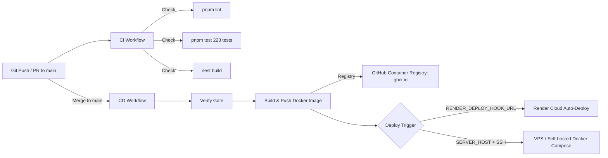

# CI/CD Pipeline Guide

Tài liệu hướng dẫn quy trình Tích hợp liên tục (CI - Continuous Integration) và Triển khai liên tục (CD - Continuous Deployment) tự động cho `crm-automation-backend`.

---

## 1. Tổng quan Kiến trúc CI/CD

---

## 2. CI Pipeline (`.github/workflows/ci.yml`)

- **Thời điểm kích hoạt:**
  - Mọi Pull Request tạo hoặc cập nhật trỏ về nhánh `main`.
  - Mọi commit push trực tiếp lên nhánh `main`.
  - Kích hoạt thủ công bằng tay (`workflow_dispatch`) từ tab Actions trên GitHub.
- **Các bước thực thi:**
  1. `actions/checkout@v4`: Lấy source code.
  2. `actions/setup-node@v4` (Node 24) & `pnpm/action-setup@v4`: Chuẩn hóa môi trường thực thi.
  3. `actions/cache@v4`: Cache pnpm store giúp giảm thời gian cài đặt dependency xuống dưới 15 giây.
  4. `pnpm install --frozen-lockfile`: Cài đặt chính xác các package theo lockfile.
  5. `pnpm lint`: Kiểm tra chất lượng mã nguồn bằng ESLint.
  6. `pnpm build`: Kiểm tra tính toàn vẹn khi biên dịch TypeScript (`nest build`).
  7. `pnpm test`: Chạy toàn bộ 223 unit & integration tests.

---

## 3. CD Pipeline (`.github/workflows/cd.yml`)

- **Thời điểm kích hoạt:**
  - Tự động chạy khi Pull Request được merge vào nhánh `main` (hoặc push vào `main`).
  - Kích hoạt thủ công bằng tay (`workflow_dispatch`) khi muốn deploy lại bất cứ lúc nào.

### Các Job chính:
1. **`verify`**: Chạy toàn bộ các bước kiểm tra (Lint $\rightarrow$ Test $\rightarrow$ Build) để làm chốt chặn chất lượng (Quality Gate).
2. **`docker_publish`**:
   - Sử dụng Docker Buildx với cơ chế cache GitHub Actions (`cache-from/cache-to: type=gha`).
   - Đăng nhập an toàn vào **GitHub Container Registry (GHCR)** qua token có sẵn của GitHub Actions (`GITHUB_TOKEN`), không cần cấu hình thêm secret.
   - Build multi-stage `Dockerfile` (Non-root `USER node`, Alpine vá bảo mật).
   - Đẩy Docker image lên `ghcr.io/tuananh-developer/crm-automation-backend:latest` và `ghcr.io/tuananh-developer/crm-automation-backend:sha-<commit>`.
3. **`deploy`**:
   - **Kịch bản 1 (Render Cloud - Khuyên dùng):** Nếu trong GitHub Secrets có `RENDER_DEPLOY_HOOK_URL`, pipeline sẽ tự động gửi webhook kích hoạt Render triển khai container/code mới nhất.
   - **Kịch bản 2 (VPS / Self-hosted Server):** Nếu cấu hình `SERVER_HOST`, `SERVER_USER`, `SERVER_SSH_KEY`, pipeline sẽ SSH vào máy chủ và chạy `docker compose pull && docker compose up -d`.
   - **Kịch bản 3 (Mặc định):** Nếu chưa cấu hình secret, pipeline sẽ build & push an toàn image lên GHCR và thông báo hướng dẫn bổ sung secret trên GitHub Summary.

---

## 4. Hướng dẫn cấu hình Deployment Secrets

Để kích hoạt tự động deploy lên server Render hoặc VPS:

1. Vào repository GitHub: **Settings** $\rightarrow$ **Secrets and variables** $\rightarrow$ **Actions** $\rightarrow$ **New repository secret**.
2. Thêm các secret tùy chọn theo hạ tầng của bạn:

| Secret Name | Mô tả | Nơi lấy giá trị |
| :--- | :--- | :--- |
| `RENDER_DEPLOY_HOOK_URL` | Webhook URL tự động deploy của Render | Dashboard Render $\rightarrow$ Service `crm-automation-backend` $\rightarrow$ Settings $\rightarrow$ **Deploy Hook** |
| `SERVER_HOST` *(Tùy chọn VPS)* | IP hoặc tên miền máy chủ production | Thông tin VPS |
| `SERVER_USER` *(Tùy chọn VPS)* | User SSH (vd: `ubuntu`, `root`) | Thông tin VPS |
| `SERVER_SSH_KEY` *(Tùy chọn VPS)* | Private SSH Key để kết nối | Private key của deploy user |
